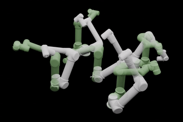
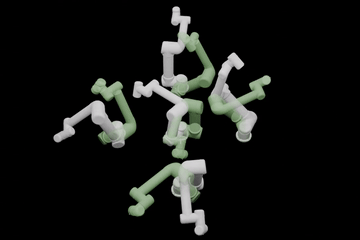

# NeHMO: Neural Hamilton-Jacobi Reachability Learning for Decentralized Safe Multi-Arm Motion Planning
[Paper](https://arxiv.org/abs/2507.13940) | [Video Demo](https://youtu.be/S-Kg7IL-I00)


<table>
  <tr>
    <td align="center">
      
    </td>
    <td align="center">
      
    </td>
  </tr>
</table>

## Introduction
We present Neural HJR-guided Multi-Arm Motion Optimizer (NeHMO), a method that learns Hamilton-Jacobi Reachability (HJR) for decentralized multi-arm motion planning. We demonstrate our method on multi-UR5 systems and also include a heterogeneous setting using a UR5 and a Kinova robot.

## Dependency
- Python 3.11 is used in this project.
- Run `pip install -r requirements.txt` to collect all python dependencies.
- [cyipopt](https://github.com/mechmotum/cyipopt) is used to solve the trajectory optimization problem. The experiments are run with the MA27 linear solver (see the [IPOPT installation guide](https://coin-or.github.io/Ipopt/INSTALL.html) for details). To install cyipopt:
```
conda install -c conda-forge cyipopt
```
- [zonopy](https://github.com/roahmlab/zonopy) and [zonopy-robot](https://github.com/roahmlab/zonopy-robots) are required by the simulation environment. Please refer to their respective repositories following the hyperlinks for installation instructions.

## Reproducing Results
All commands below are run from the repository root.

### Planning Experiments
 - To download the trained HJR models from Google Drive:
```
pip install gdown
gdown --folder https://drive.google.com/drive/folders/1JuIAfa-2UHhuDMRdOxaDspDKPXtUevaG?usp=sharing
```

 - To run manipulator planning experiments:
```
bash planning_scripts/run_UR5_planning.sh         # Dual UR5
bash planning_scripts/run_triple_UR5_planning.sh  # Three UR5
bash planning_scripts/run_five_UR5_planning.sh    # Five UR5
bash planning_scripts/run_UR5_Kinova_planning.sh  # Heterogeneous UR5 + Kinova Gen3
```
The heterogeneous experiment uses a separate value function per arm, so it needs both the `experiment_symmetric_IC_seed1` and `experiment_symmetric_IC_Kinova_seed1` checkpoints under `hji_logs/logs_nn_UR5_Kinova/`. Its three variants are selected with `--planner_mode`: `simple` (Naive / Naive), `hji` (NeHMO / NeHMO), and `hji_simple` (NeHMO / Naive). Start and goal pairs are read from `envs/collision_initial_conditions.json`, which fixes this experiment at 100 trials.

For visualizations, specify the `--video` flag in the bash scripts. The experiments write planning results as a JSON file under `planning_results/`; substitute `--save_stats` with `--save_traj` to also save the planned trajectories.

### Learning Experiments
 - To download the validation sets from Google Drive:
 ```
 gdown --folder https://drive.google.com/drive/folders/1I5blpIog4UybxKygOESfnkWUNMNZmXvu?usp=sharing -O deepreach/
 ```

  - To run the learning experiments:
  ```
  bash deepreach/launch_scripts/launch_air3D_training.sh
  bash deepreach/launch_scripts/launch_simplearm_training.sh
  bash deepreach/launch_scripts/launch_nn_arm_training.sh
  ```

  Note that to run the manipulator training example, the user needs to acquire the learned distance boundary condition model by
  ```
  gdown --folder https://drive.google.com/drive/folders/1w8HmZ9S_PWs1gPAbXUaYyyw7F2RM_om6?usp=sharing -O UR5_datasets_and_training/
  ```
The `UR5_datasets_and_training/` directory also contains the code to train the boundary condition models for reference.


## Credits and Acknowledgments
- A majority of the code for HJR learning is adopted from [DeepReach](https://github.com/smlbansal/deepreach). We thank the authors and maintainers for their amazing work.
- The simulation environment is adopted from [Sparrows](https://roahmlab.github.io/sparrows/). We thank the authors and maintainers for their amazing work.

## Citation
If you find NeHMO useful, please consider citing using the following BibTex entry:
```
@inproceedings{chen2026nehmo,
      title={{NeHMO}: Neural {Hamilton-Jacobi} Reachability Learning for Decentralized Safe Multi-Arm Motion Planning},
      author={Chen, Qingyi and Kingston, Zachary and Qureshi, Ahmed H.},
      booktitle={Proceedings of the IEEE/RSJ International Conference on Intelligent Robots and Systems (IROS)},
      year={2026},
      address={Pittsburgh, PA, USA},
      month=sep,
      note={arXiv:2507.13940},
}
```
